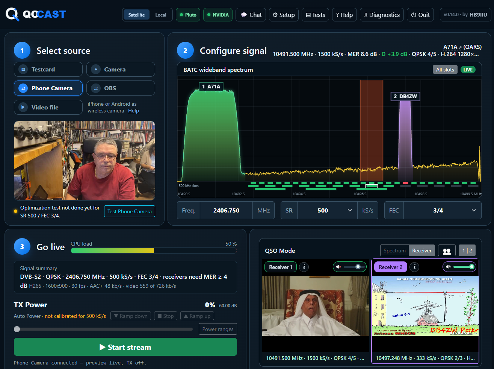

# QOCAST

**Browser-controlled QO-100 DATV transmit and receive console for Windows**, by HB9IIU.

# Developed and tested on a PC with an NVIDIA graphics card

Other PCs (Intel or AMD graphics, or the processor alone) are supported too, with less testing.

QOCAST sends DVB-S2 video to the QO-100 satellite with an ADALM-Pluto
(PlutoDVB2 firmware by F5OEO), and shows what comes back with one or two
receivers (MiniTiouner, PicoTuner or RTL-SDR). You control everything from one
page in your browser, the received pictures included.

## What's new in 0.15.0

- **Local mode** works with the new receivers: the Pluto transmits where your receiver listens (the offset is set by itself), so a MiniTiouner, a PicoTuner or an RTL-SDR dongle hears it. A click on the simulated signal tunes the receiver.
- **Recording:** each receiver can record what it receives (the **i** button, **Rec**). One folder per callsign, the file name is the date and time. A red blinking **Rec.** shows while recording.
- **Your TX slot is checked** against the real spectrum. A warning appears when another signal is inside the band your symbol rate needs, also when it becomes busy after you chose the slot. Start refuses until you choose another slot or a lower symbol rate.
- **CPU load bar:** it shows how much of the load is QOCAST (with its FFmpeg and receivers), OBS and others.
- **Two tuners:** QSO mode opens by itself at the start, and the second receiver tunes the beacon. A receiver that decodes nothing for 60 seconds goes back to the beacon by itself.
- A MiniTiouner that another program is using (for example the MiniTiouner program) is skipped: the receivers use the next tuner, for example a PicoTuner.
- **Video file:** a trash button deletes the selected film (after asking).
- **Setup, Interface:** the message box under the Start stream button can be shown or hidden (hidden by default).

Older versions: see the **[Releases](../../releases)** page.

## What makes QOCAST different

Like other DATV tools, QOCAST starts from a table of encoder settings for each
symbol rate and FEC (picture size, bitrates, audio). But a fixed table only fits
"average" pictures: a detailed film or a busy camera scene can need more than
the profile carries, and the stream overflows - viewers see glitches.

So QOCAST **tests what you actually send**, and adapts the settings to it:

- **Films:** at the first Start with a profile, QOCAST finds the three hardest
  30-second parts of the film, encodes them with the exact transmit command, and
  steps down only as far as needed (NVENC multipass, then a smaller picture, then
  fewer frames per second) until the stream has no overflows and keeps spare room.
  If there is room left over, the video gets more bitrate. The result is saved
  next to the film: the next Start is immediate.
- **Camera, phone camera and OBS:** a 20-second test, per profile, with your own scene
  (your room, your light, your phone in your hand), then the same check.
- **Testcards:** the moving ones (SBB clock, station card with marquee) are
  shipped with settings already tested for every profile.
- **On air:** QOCAST keeps watching. If a film still overflows, it is checked
  again, more carefully, at its next Start; for live sources the page says so.

Also built in:

- **Signal health at a glance:** one line tells you if your stream is good, too
  full or has errors, with a live bitrate bar (video, audio, overhead, spare) and
  TR 101 290 checks behind it.
- **See yourself come back:** while you stream, receiver 1 is tuned to
  your downlink, so you see your own picture received back through QO-100.
- **Start, then raise the power:** the stream starts muted; the Pluto only
  transmits when you raise the TX power above 0%.
- **The phone camera and OBS stay connected:** connect them once; start and
  stop the transmission as often as you like without touching the phone or OBS.
- **Use it from any device:** open `http://qocast.local:6969` on a tablet,
  phone or another PC on your home network.
- **Nothing to install or configure:** unzip and start. The receivers
  start with QOCAST, find your tuner by themselves and close at Quit.

## Download

Get the latest `QOCast-Portable-x64.zip` from the **[Releases](../../releases)** page.
No installation: unzip it to a writable folder and run `QOCast.exe`.
To update: unzip the new version, then copy the `data` folder of the old version into the new one
(it holds your settings, films, pictures and music).

## Features

- **Sources:** testcards with melody (SBB clock, station card with marquee,
  classic test card), your own pictures and slideshows (with your own music),
  webcam with microphone, phone camera (iPhone with Moblin, Android with
  QOCAST Cam), OBS, video files
- **Settings that fit:** every film, camera, Moblin or OBS source is checked
  once per profile, so the stream fits the QO-100 bitrate without overflows
- **BATC wideband spectrum:** click a free (green) slot to choose your
  frequency, click a signal to receive it
- **One or two receivers:** the received picture and sound in the page, with its own
  volume and settings for each receiver (QSO mode)
- **Start, then raise the power:** the stream runs muted until the TX power is above 0%
- **TX monitor:** live preview of what you send, and your signal received back
- **Local Pluto RX spectrum:** see your own carrier
- **Calibrate** on the QO-100 beacon corrects the LNB and tuner frequency error, and a
  **Local mode** lets you test without the satellite
- **Overlays** on camera and phone camera: callsign, locator, UTC time, scrolling text
- **Sound sync:** camera sound and picture in step, measured by clapping
- **Signal health:** status in words, live bitrate bar, TR 101 290 checks
- **BATC wideband chat** built in
- **Help page:** step-by-step setup of the phone camera (iPhone or Android), OBS,
  Local mode, receiving a station, connecting the Pluto

## Requirements

- Windows 10 or 11, 64-bit
- An **NVIDIA graphics card** (the video is encoded with NVENC, H.265)
- **ADALM-Pluto** with the **PlutoDVB2 firmware** (F5OEO), connected by USB
  or Ethernet. Firmware download:
  [github.com/F5OEO/plutosdr-fw/releases](https://github.com/F5OEO/plutosdr-fw/releases)
  Also works with the **Tezuka** firmware
  ([github.com/F5OEO/tezuka_fw](https://github.com/F5OEO/tezuka_fw)) that has the DATV modulator
  (boards with the Zynq 7020 chip, such as the FISHBall 7020).
  **Supported firmware: only the official ones from the two addresses above.** Custom builds,
  for example numbered 0303, 2402 or 0201, have been reported to behave strangely (a PTT that
  stays muted, MQTT errors). QOCAST cannot guarantee that they work, and we will not adapt
  QOCAST to them.
- Optional, for receiving: a **MiniTiouner** or **PicoTuner** (USB) with its driver
  installed in Windows, or an **RTL-SDR**, and an LNB for the QO-100 downlink

## Starting and quitting

1. Run `QOCast.exe`. The page opens in your browser at
   http://localhost:6969, and the receiver starts on the QO-100 beacon.
2. On the first start, a welcome box asks for your callsign, name and locator,
   and looks for your Pluto by itself.
3. To end: the **Quit** button at the top of the page.

Other devices on your network can use `http://qocast.local:6969` (or
`http://<this-PC-address>:6969`). There is no password: anyone on your home
network can open it.

## Antivirus warning

Some antivirus programs (such as Norton or Microsoft Defender) may incorrectly flag or quarantine QOCAST files.

QOCAST is a free, open-source amateur radio project. Since the application is not digitally signed and is not widely distributed, some security programs may consider it suspicious.

**This is a known issue with small, independent software projects, not necessarily an indication of malware.**

Don't just take my word for it! Microsoft explains the issue in its official documentation:

- [Why Windows may distrust unsigned applications (Microsoft)](https://support.microsoft.com/en-us/windows/security/threat-malware-protection/smart-app-control-frequently-asked-questions)
- [How to report false antivirus detections (Microsoft)](https://learn.microsoft.com/en-us/defender-xdr/submission-guide)

**If your antivirus quarantines a QOCAST file:**

1. Make sure you downloaded QOCAST from the official GitHub project.
2. Check the detection and verify that it is a false positive before restoring the file.
3. Restart QOCAST.

You can also report a suspected false positive to your antivirus provider to help prevent future warnings.

## Included third-party software

The licences are in the `licenses` folder.

- **FFmpeg** (the encoder: LGPL 2.1, with the Fraunhofer FDK AAC encoder; the receivers use a GPL v3 build),
  **TSDuck** and the **Varela Round** font.
- The **tuner service** (MiniTiouner and PicoTuner) contains tuner code from OpenTuner by Tom ZR6TG
  and is therefore GPLv3. Source code:
  **[github.com/HB9IIU/QOCAST-OpenTuner](https://github.com/HB9IIU/QOCAST-OpenTuner)**
- **datvrx** and **rtl_iq** (the RTL-SDR receiver) come from DATVision by HB9IIU, which is built on OnAir (GPLv3).
  Source code: [github.com/HB9IIU/DATVision](https://github.com/HB9IIU/DATVision) and
  [github.com/adswill/OnAir](https://github.com/adswill/OnAir)

## Credits

- **Evariste F5OEO** for the PlutoDVB2 firmware
- **Tom ZR6TG** for OpenTuner, whose tuner code the tuner service uses
- **OnAir** (adswill) for the receiver code that DATVision builds on
- **F1EJP** for DATV-Easy, the reference for the encoder settings
- **BATC** for the QO-100 wideband spectrum monitor and chat
- **AMSAT-DL** and everyone who keeps QO-100 running
- **Jochem PE0JHM** and **Peter PF2A** for their testing and their valuable feedback

73 from HB9IIU!
