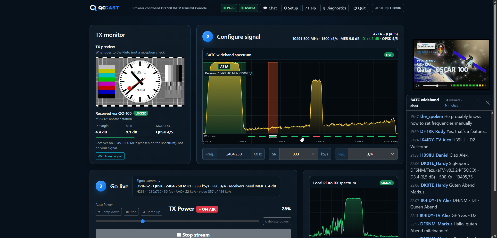

# QOCAST

**Browser-controlled QO-100 DATV transmit and receive console for Windows**, by HB9IIU.

QOCAST sends DVB-S2 video to the QO-100 satellite with an ADALM-Pluto
(PlutoDVB2 firmware by F5OEO), and shows what comes back with a MiniTiouner or
PicoTuner. You control everything from one page in your browser; the received
picture plays in its own small window, the **QOCAST Player**.

## What's new in 0.10.0

- **OpenTuner is left alone:** QOCAST no longer closes a running OpenTuner when it starts.
- **PicoTuner (USB) now works:** tested with a real PicoTuner. Thank you Jochem PE0JHM for testing it!
- **RF input and LNB voltage (Setup → Receiver):** choose input A or B and LNB voltage Off / 13 V / 18 V. The receiver starts on input A with the voltage Off.
- **After a transmission the receiver goes back to the station you were listening to** (it used to stay on the beacon). PE0JHM request.
- **The "No NVIDIA encoder: software encoding" message is shown once**, not every time the page is opened.
- **OpenTuner running:** when the Player finds no tuner and OpenTuner is running, its window says so ("please close OpenTuner").
- **All your own files are in one folder, `data`:** settings, camera tests, the Player settings (`data\player`), your films (`data\videos`), pictures (`data\pictures`) and music (`data\music`). To update: unzip the new version and copy the old `data` folder over. Files from the older layout are moved into `data` by themselves at the first start.

## What's new in 0.8.0

- **Satellite | Local switch in the top bar:** one click to change the mode (not while on air), with a reminder of what to do with the antenna and the LNB cable. It is no longer in Setup.
- **QOCAST Player:** the bottom bar now shows the signal after the callsign: symbol rate, MER, margin and FEC. It uses a fixed-width font, so the values don't shake when they change.
- **Power ranges window (replaces Calibrate power):** a button next to the TX power slider opens one window with a row per symbol rate (125, 250, 333, 500, 1000 kS/s). Two handles set 0% and 100% of the slider for each rate, with Reset per row and one Save. A rate you have not set uses the full range (-60 to 0 dB).
- **New symbol rate 125 kS/s:** for very narrow signals (640x360 picture, about 50 to 110 kb/s of video, depending on the FEC).
- **Magic Eye:** a green phosphor "cat eye" in the card of your own signal shows at a glance how well it comes back: almost closed at 0 dB of margin, fully open at 5 dB or more, dark without a lock. It replaces the thin quality bar. Inspired by the [Lynx DATV Receiver by G8YTZ](https://github.com/G8YTZ/lynx-datv-receiver).

## What's new in 0.7.0

- **Compatible with Tezuka firmware.**
- **OBS browser overlays:** add a transparent SBB-style clock in local time or UTC, and a live weather bar for the station locator.
- **Custom LNBs:** enter the nominal LNB LO frequency in Setup (9750.000 MHz by default), then use beacon calibration for the exact effective offset.
- **Camera diagnostics:** Start now shows each camera-launch stage, saves a detailed support log, times out if the preview cannot release the camera, and exports everything from the new Diagnostics button.
- **Pluto details:** click the Pluto button to see its hardware and firmware (e.g. Tezuka version), its IP address and, when it reports one, the DVB modulator version.
- **Phone camera logo:** a small logo in the top left corner, under the banner, on the Phone Camera pictures (switch it on in Setup).
- **Find the Pluto:** a Find button next to the Pluto IP address in Setup looks for the Pluto on the PC's networks and fills in the address; it also runs by itself when Setup is opened from the "No Pluto found" box. If the Pluto is plugged in by USB but has no network, it says so.
- **Save in Setup** returns to the console by itself after a second.
- **The first Start of a film is explained:** the box under Start says what is happening (the film is tested once, about a minute) and each step in plain words.
- **A quieter Start:** the box under the Start button no longer shows the support code on every Start, only when a Start fails.
- **Calibrate power:** a button next to the TX power slider, in three steps, so the slider covers exactly your range. Reset goes back to the full range.
- **Ramp up / Ramp down:** two buttons that move the slider slowly (30 steps, 3 seconds). Ramp up needs the power calibrated first. Ramp down to 0% also stops the stream.
- **Your own testcards:** a "pictures" folder next to QOCast.exe. A picture becomes a testcard; a folder of photos becomes a slideshow (random order, a new photo every 10 seconds).
- **Demo pictures and a demo slideshow** come with QOCAST, as examples for the first start.
- **Soundtrack:** songs in a "music" folder play in random order on your own pictures and slideshows, instead of the melody.
- **NVIDIA button** in the top bar: green when the NVIDIA H.265 encoder was found, red when not. Click it for a popup: graphics card, driver, encoder, temperature gauge, loads, memory, power and fan.
- **The chat is a centred window** that does not block the page: draggable, resizable, foldable, with "who is in the chat" (callsigns link to QRZ.com).
- **Pluto temperatures:** both the AD9361 radio chip and the Zynq processor in Signal health, with a one-hour plot and two analogue gauges. Wrong readings are filtered out.
- **Welcome screen on the first start:** callsign, name and locator in one box, and QOCAST finds the Pluto by itself.
- **Help for the Phone Camera:** asks "iPhone or Android?" and shows only that phone's steps.
- **QOCAST Cam for Android:** a QR code in Help downloads the camera app from this PC.

## What's new in 0.6.0

- **OBS browser overlays:** add a transparent SBB-style clock in local time or
  UTC, and a live weather bar for the station locator.
- **Custom LNBs:** enter the nominal LNB LO frequency in Setup (9750.000 MHz by
  default), then use beacon calibration for the exact effective offset.
- **Camera diagnostics:** Start now shows each camera-launch stage, saves a
  detailed support log, times out if the preview cannot release the camera,
  and exports everything from the new Diagnostics button.
- **Fixed:** QOCast.exe has the QOCAST icon again instead of the Python icon.

## What's new in 0.5

- **Practise at home – Local mode, explained:** train in your shack without the
  satellite, with exactly the same experience. A new Help topic has two sketches
  (normal and local mode), also in Setup under "How to set it up".
- **New version notice:** at start, QOCAST checks GitHub once. If a newer version
  is out, a popup shows "What's new" with Later and Download buttons.
- **Top banner with weather:** for Camera and Moblin, choose None, Classic or With
  weather. It shows the current weather at your locator and the nearest town.
- **Station card sound meters:** two segmented meters move with the melody, with
  peak hold.
- **QRZ.com link:** the received station's callsign links to its QRZ.com page.
- **Improved Setup and chat**, clearer NVIDIA and Pluto warnings, and simpler
  startup by double-clicking QOCast.exe.
- **Fixed:** the QOCAST Player's VU-meter segments have equal widths again.

## What's new in 0.4

- **Sound sync for cameras:** many webcams deliver the sound a few hundred
  milliseconds after the picture. Press **Sound sync**, clap a few times in
  front of the camera, and QOCAST measures the delay and corrects it on air.
  One value per camera, also editable on the Setup page.
- **QOCAST Player, new look:** no title bar (drag the picture to move it), and a
  bottom bar with volume, mute, a VU meter and the received station's callsign.
- **Pluto over Ethernet:** the Help page explains how to give the Pluto a fixed
  address on your home network.
- Clearer camera test (the countdown starts only when the camera really
  records), a tidier Setup page, and fixes for webcams without MJPEG such as
  the Microsoft LifeCam Studio.

## What's new in 0.3.2

- **Pluto frequency correction:** after each transmission via QO-100, QOCAST
  compares your signal with the beacon and corrects your Pluto's frequency, so
  it transmits right on your slot (a Pluto is often 10-50 kHz off at 2.4 GHz).
- **The LNB is followed automatically** on the beacon; every correction is
  announced on the page.
- **Your own signal is found by itself** after PTT, no more clicking.
- The received station on two lines next to "Configure signal" (with the
  provider name), and a tidier header.

## What's new in 0.3

- **LNB calibration:** the Setup page shows your LNB's real oscillator
  frequency. **Recalibrate** locks on the QO-100 beacon five times and corrects
  it, in about 30 seconds.
- **Local mode:** try the whole chain without the satellite. The receiver
  listens to your Pluto directly on 2.4 GHz (small antenna on the tuner, LNB
  power off), and the spectrum shows your signal simulated at your slot, as
  high as your TX power.
- **Sound meter** on the camera picture: one small bar showing the sound as it
  is sent.
- **Sound offset** for the camera (Setup): if your sound comes after the
  picture, enter how much, and it is corrected for every viewer.
- **Signal health warns** when the picture falls behind (a growing delay) or
  the stream has no sound.
- **More reliable reception of your own signal** when you press PTT.
- **tx_log.csv:** one line per transmission with your own signal as received
  (frequency error, MER, Pluto temperature), to see whether your Pluto's
  frequency error is reproducible.

## What's new in 0.2: no more video in the browser

In 0.1, received video was shown inside the web page: OpenTuner received the
signal, QOCAST converted it to a format browsers can play, and the page played
it. It worked, but it was never good enough for DATV. The picture lagged
seconds behind, stalled, and every change of station or resolution meant
starting over. Browser video players are made for internet streaming, with
large buffers. A live picture from the satellite needs the opposite.

So 0.2 drops that idea completely:

- **New: the QOCAST Player.** A small window that plays the tuner's stream
  directly with VLC: picture and sound, no conversion and no browser in
  between. The picture appears about a second after tuning. QOCAST starts it,
  it finds your MiniTiouner or PicoTuner by itself, and it closes at Quit.
  Right-click the picture for mute, volume and "always on top".
- **OpenTuner is no longer needed.** It is not in the package any more, and
  QOCAST closes an OpenTuner that is still running, so it can't keep the tuner
  busy. The Player uses OpenTuner's proven tuner code (thanks, Tom ZR6TG).
- **Receive from the main page.** The separate RX page is gone. Click a signal
  on the BATC spectrum to receive it: a green band marks it, with the station's
  callsign once locked. A line next to "Configure signal" shows lock, MER,
  D margin and MODCOD. At start, the receiver is on the QO-100 beacon.
- **TX monitor (was "On-air monitor").** While you stream, it shows a small,
  live **TX preview** of the encoded picture you actually send to the Pluto,
  already before PTT. Below it, your signal received back through QO-100, with
  MER and D margin.
- **Smaller download:** about 130 MB instead of more than 300 MB.

Also new: a built-in BATC wideband chat, a camera preview that recovers by
itself when the webcam gives no picture, a microphone compressor for the
camera, and clearer messages in the log. The full list is on the
**[Releases](../../releases)** page.

## What makes QOCAST different

Like other DATV tools, QOCAST starts from a table of encoder settings for each
symbol rate and FEC (picture size, bitrates, audio). But a fixed table only fits
"average" pictures: a detailed film or a busy camera scene can need more than
the profile carries, and the stream overflows - viewers see glitches.

So QOCAST **tests what you actually send**, and adapts the settings to it:

- **Films:** at the first Start with a profile, QOCAST finds the three hardest
  30-second parts of the film, encodes them with the exact transmit command, and
  steps down only as far as needed (NVENC multipass, then a smaller picture, then
  fewer frames per second) until the stream has no overflows and keeps spare room.
  If there is room left over, the video gets more bitrate. The result is saved
  next to the film: the next Start is immediate.
- **Camera, phone camera and OBS:** a 20-second test, per profile, with your own scene
  (your room, your light, your phone in your hand), then the same check.
- **Testcards:** the moving ones (SBB clock, station card with marquee) are
  shipped with settings already tested for every profile.
- **On air:** QOCAST keeps watching. If a film still overflows, it is checked
  again, more carefully, at its next Start; for live sources the page says so.

Also built in:

- **Signal health at a glance:** one line tells you if your stream is good, too
  full or has errors, with a live bitrate bar (video, audio, overhead, spare) and
  TR 101 290 checks behind it.
- **See yourself come back:** while you stream, the QOCAST Player is tuned to
  your downlink, so you see your own picture received back through QO-100.
- **Start, then raise the power:** the stream starts muted; the Pluto only
  transmits when you raise the TX power above 0%.
- **The phone camera and OBS stay connected:** connect them once; start and
  stop the transmission as often as you like without touching the phone or OBS.
- **Use it from any device:** open `http://qocast.local:8080` on a tablet,
  phone or another PC on your home network.
- **Nothing to install or configure:** unzip and start. The QOCAST Player
  starts with QOCAST, finds your tuner by itself and closes at Quit.

## Download

Get the latest `QOCast-Portable-x64.zip` from the **[Releases](../../releases)** page.
No installation: unzip it to a writable folder and run `QOCast.exe`.
To update: unzip the new version, then copy the `data` folder of the old version into the new one
(it holds your settings, films, pictures and music).

## Features

- **Sources:** testcards with melody (SBB clock, station card with marquee,
  classic test card), your own pictures and slideshows (with your own music),
  webcam with microphone, phone camera (iPhone with Moblin, Android with
  QOCAST Cam), OBS, video files
- **Settings that fit:** every film, camera, Moblin or OBS source is checked
  once per profile, so the stream fits the QO-100 bitrate without overflows
- **BATC wideband spectrum:** click a free (green) slot to choose your
  frequency, click a signal to receive it
- **QOCAST Player:** the received picture and sound in their own window
- **Start, then raise the power:** the stream runs muted until the TX power is above 0%
- **TX monitor:** live preview of what you send, and your signal received back
- **Local Pluto RX spectrum:** see your own carrier
- **LNB calibration** on the QO-100 beacon, and a **Local mode** to test
  without the satellite
- **Overlays** on camera and phone camera: callsign, locator, UTC time, scrolling text
- **Sound sync:** camera sound and picture in step, measured by clapping
- **Signal health:** status in words, live bitrate bar, TR 101 290 checks
- **BATC wideband chat** built in
- **Help page:** step-by-step setup of the phone camera (iPhone or Android), OBS,
  Local mode, receiving a station, connecting the Pluto

## Requirements

- Windows 10 or 11, 64-bit
- An **NVIDIA graphics card** (the video is encoded with NVENC, H.265)
- **ADALM-Pluto** with the **PlutoDVB2 firmware** (F5OEO), connected by USB
  or Ethernet. Firmware download:
  [github.com/F5OEO/plutosdr-fw/releases](https://github.com/F5OEO/plutosdr-fw/releases)
  Also works with a **Tezuka** firmware that has the DATV modulator (boards with
  the Zynq 7020 chip, such as the FISHBall 7020).
- Optional, for receiving: a **MiniTiouner** or **PicoTuner** with its USB
  driver installed in Windows, and an LNB for the QO-100 downlink

## Starting and quitting

1. Run `QOCast.exe`. The page opens in your browser at
   http://localhost:8080, and the QOCAST Player window opens on the QO-100
   beacon.
2. On the first start, a welcome box asks for your callsign, name and locator,
   and looks for your Pluto by itself.
3. To end: the **Quit** button at the top of the page.

Other devices on your network can use `http://qocast.local:8080` (or
`http://<this-PC-address>:8080`). There is no password: anyone on your home
network can open it.

## Included third-party software

QOCAST ships with FFmpeg (LGPL 2.1, with the Fraunhofer FDK AAC encoder),
TSDuck, the Varela Round font, and the QOCAST Player. The Player contains
tuner code from OpenTuner by Tom ZR6TG and is therefore GPLv3; it plays video
with LibVLC by VideoLAN (LGPL 2.1). The licences are in the `licenses` folder.

Source code of the QOCAST Player:
**[github.com/HB9IIU/QOCAST-OpenTuner](https://github.com/HB9IIU/QOCAST-OpenTuner)**

## Credits

- **Evariste F5OEO** for the PlutoDVB2 firmware
- **Tom ZR6TG** for OpenTuner, whose tuner code the QOCAST Player uses
- **VideoLAN** for VLC
- **F1EJP** for DATV-Easy, the reference for the encoder settings
- **BATC** for the QO-100 wideband spectrum monitor and chat
- **AMSAT-DL** and everyone who keeps QO-100 running

73 from HB9IIU!
